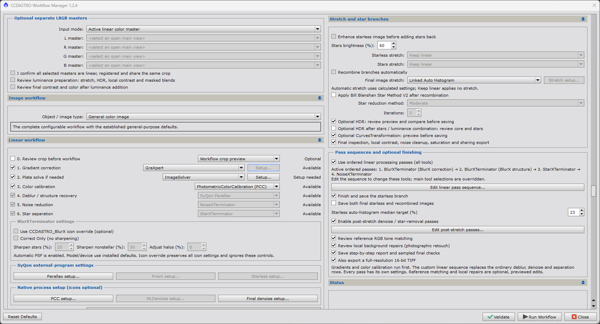

# CCDASTRO PixInsight Workflow Manager v1.2.6



A configurable PixInsight workflow for integrated linear color images or separate
registered LRGB masters. Choose processing tools and review stretching, masks and
finishing adjustments before applying them.

[Workflow webpage](https://ccdastro.com/piworkflow.html) · [Short video](https://youtu.be/0G-PI8F51rE) · [CCDASTRO home](https://ccdastro.com/)

## New in v1.2.6

Manual plate-solve setup is saved for the same image and retained across reopening and implicit LRGB autofill. Explicit Autofill can still replace it. Logs show the selected seed coordinates and sample format; 8-bit inputs are rejected before processing.

## New in v1.2.5

Fix tool-selection refresh errors and corrupted punctuation in advanced dialogs. Place Skip repairs beside Apply instead of over the instructions. Missing observation-time metadata now produces an actionable error before Gaia plate solving begins.

## New in v1.2.4

The main window uses two columns on wider screens: input and linear tools on the left, stretching and finishing on the right. Smaller screens keep a single column. Validate and Run stay fixed below the scroll area.

## New in v1.2.3

The pass summary now displays actual tool names alongside custom pass labels.
With ordered passes disabled it follows the enabled main tool selections and noise placement.
With ordered passes enabled it identifies the active sequence and explains that it overrides the main tool rows.

## New in v1.2.2

Ordered passes now support all sharpening, denoise and star-removal tools already
offered by the workflow: BlurX, SyQon Parallax, NoiseX, MLDenoise, SyQon
Prism/DeepPrism, StarX, StarNet2 and SyQon Starless. ACDNR and
MultiscaleLinearTransform are also available as repeatable denoise passes.

Enable **Use ordered linear processing passes (all tools)**, edit the sequence,
then use **Tool-specific setup for this pass...** for independent model/path and
strength settings. Mix, duplicate and reorder tools. Native process icons can be
named separately for each pass; StarNet2 uses installed defaults or its selected
icon. Linear/mask modes follow the stage. BlurX and Parallax remain linear-only.

The workflow script and update manifest are signed for the CCDASTRO identity.

## New in v1.2.1

Enable **Save both final starless and recombined images** under **Pass sequences
and optional finishing**. The workflow finishes and saves starless first, then
reviews stars recombination and saves a separate companion. Default filenames
end in `_Starless.xisf` and `_Recombined.xisf`; the second save cannot overwrite
the first. Each selected TIFF/report/sharing export is available for both outputs.
Skipping the recombination review keeps the finished starless result.

The workflow script and update manifest are signed for the CCDASTRO identity.

## New in v1.2.0

Ordered linear BlurX/NoiseX/StarX passes, full starless finishing, optional
post-stretch cleanup, reference RGB matching, reviewed background repairs,
TIFF export and step-by-step reports are now integrated into the workflow.
See [the v1.2.0 guide](docs/ADVANCED-WORKFLOW.md) for settings and validation.

## Install with PixInsight Update Manager

1. Choose **Resources > Updates > Manage Repositories**, click **Add**, and paste:

   ```text
   https://raw.githubusercontent.com/CCDASTRO/PixInsight-Workflow-Manager/main/updates/
   ```

2. Close Manage Repositories and choose **Resources > Updates > Check for Updates**.
3. Download CCDASTRO Workflow Manager, exit PixInsight, and restart after installation.
4. Open **Script > CCDASTRO > Workflow Manager**.

Keep this repository entry for future updates. Paste the URL into Manage
Repositories; you do not need a release ZIP. If the menu is missing, choose
**Script > Feature Scripts > Add**, select the installed `src/scripts` directory,
scan, and restart.

## Install manually as a Feature Script (advanced alternative)

Most users should use **Install with PixInsight Update Manager** at the top of
this page. Manual installation is an alternative, not an additional required step.

1. Download or clone this repository.
2. Locate PixInsight's installed `src/scripts` directory.
3. Create `src/scripts/CCDASTRO` and copy `CCDASTROWorkflowManager.js` and
   its matching `CCDASTROWorkflowManager.xsgn` signature and the included
   `CCDASTROAutoDBEEngine.jsh` into it. Also include `CCDASTROAdvancedWorkflow.jsh` for v1.2.0. All four files must be from the same signed release.
   This sibling location is required because the workflow uses PixInsight's installed
   `src/scripts/ImageSolver` library.
4. Start PixInsight and choose **Script > Feature Scripts**.
5. Click **Add** and select the new `src/scripts/CCDASTRO` directory.
6. Enable recursive search if available and allow the feature scan to finish.
7. Open **Script > CCDASTRO > Workflow Manager**.

The GitHub `tree/main/pixinsight` webpage is not an update URL. Use the raw
`updates/` URL above for Update Manager or use the installed scripts directory
for a manual Feature Scripts installation.

## Requirements

- PixInsight 1.9.4 or 1.9.5 with its standard ImageSolver library. See the
  [compatibility checklist](docs/PIXINSIGHT-1.9.5.md) for verification details.
- Integrated, unstretched color data or registered linear L/R/G/B masters;
  Float32 XISF is recommended. Display STF is acceptable; a permanent stretch is not.
- Installed tools, compatible models and licenses for your selected stages.
- Approximate coordinates and image scale when plate solving is required.

WBPP normally supplies integrated filter masters. Inspect calibration, gradients,
clipping, alignment, noise and integration borders before processing. The workflow
does not calibrate, integrate, align or PSF-match masters. Identical dimensions do
not prove registration. Later processing cannot recover clipped or missing detail.

## Quick start

1. Open your unstretched color master, or registered linear L/R/G/B masters.
2. Launch **Script > CCDASTRO > Workflow Manager** and select the input mode.
3. Choose an **Object / image type**, then adjust the displayed stages and tools.
   Open setup for entries marked **Setup needed**. Icons are optional overrides.
4. Choose denoise placement and a final stretch. Keep branches linear for normal
   star recombination; enable starless enhancement to finish the nebula separately.
5. Confirm linear input, **Validate**, resolve errors, then **Run Workflow**.
6. In each review, **Update Preview**, compare at 100%, and Apply or Skip.
7. Save the full-resolution XISF, then optionally export a sharing copy.

Original pixels and input files are preserved through separate working copies.
Save unsaved originals separately for a permanent backup. The manager hides while
processing and returns afterward; follow the Process Console. Cancelling a save
leaves the result open. Accepted repeated passes accumulate; preview updates do not.

## Workflow Manager interface

Select the processing steps with the checkboxes, choose the desired tool for
each step, and click **Run Workflow**. The manager runs the selected steps in
the required order.

**During the run, this settings window is hidden to keep the Process Console
visible. It returns automatically when the run ends.**

## Direct process setup and optional icons

Native choices offer direct workflow setup. Workspace icons
are optional advanced overrides. Enable **Remember workflow settings** to retain
these settings and paths; without it, edits last for the current session.
**Reset Defaults** restores tool defaults and disables overrides.

| Choice | Where to configure it |
| --- | --- |
| PCC | Select PCC, then **PCC setup...** under Native process setup |
| MLDenoise | Select MLDenoise, then **MLDenoise setup...** |
| SPFC + MGC | Select MGC, then the gradient row's **Setup...**: SPFC, MGC and plate-solve setup open in order |
| HistogramTransformation / MAS | Select it under Final image stretch, then **Stretch setup...** |
| Luminance HistogramTransformation | Select the histogram option in luminance preparation, then **L stretch setup...** |
| Final noise cleanup | **Final denoise setup...** in the manager, or **Denoise setup...** in the cleanup review |

Click **Save settings**, then **Validate** for selected linear stages and final
stretch. Setup does not run a process on an image. All runs use working copies.
An open standalone process window does not change workflow settings. Optional
icons are read only when their explicit **Use icon override** checkbox is enabled.
Missing model/MARS files and identity histogram stretches need setup before use.
Licenses, model compatibility, catalog access and MARS sky coverage are checked
by the native tools during execution; file existence does not establish these.

## Select an object or image type

Select the profile before choosing individual tools. Changing the profile loads
its recommended settings and hides stages that do not apply. These are starting
points: every displayed stage can still be enabled, disabled, or configured.

| Profile | Presented workflow |
| --- | --- |
| General color image | Complete configurable workflow |
| Broadband color emission nebula | SPCC, star separation, starless denoise, recombination, stretch, and optional star reduction |
| Mapped narrowband color emission nebula | Gradient, deblur, star separation, starless denoise, recombination, and stretch; broadband SPCC is omitted |
| Galaxy | SPCC, structure recovery, starless denoise, recombination, and a restrained stretch |
| Star cluster | SPCC, conservative full-image deblur and denoise, and direct full-image stretch without star separation |
| Custom workflow | All available stages using the current selections |

The mapped narrowband profile expects an already combined mapped-color master.
It does not perform HOO or other palette construction. Use the General or Custom
profile when the image needs different color treatment.

The default General Color Image order is:

1. Optional interactive DynamicCrop handoff
2. Selected gradient correction (MGC performs its prerequisite solve and SPFC first)
3. ImageSolver when the image does not already have an astrometric solution
4. Selected color calibration: SPCC (default) or configured PCC
5. BlurXTerminator or SyQon Parallax
6. StarXTerminator, StarNet2, or SyQon Starless
7. NoiseXTerminator, MLDenoise, or SyQon Prism on the starless branch
8. Linear-add PixelMath recombination
9. One linked automatic histogram stretch on the recombined image

## Configure optional cropping

Enable **Review crop before workflow**, then Run Workflow. Drag a rectangle
in the preview and select **Apply Crop** or **Skip Crop**. The manager returns with
the working copy selected and Crop unchecked. Validate before continuing.
The preview stretch affects only the display; working pixels remain linear.
For rotation, use native DynamicCrop before starting. In separate LRGB mode,
leave workflow crop off and use identically cropped masters.

## Choose the input: color master or separate LRGB masters

WBPP normally provides integrated filter masters. This optional mode handles RGB
combination and adds separately stretched luminance after RGB finishing, before
the final HDR review.

1. Open registered, **linear** L, R, G and B masters before launching the workflow.
   Select **Separate linear R, G, B + L** and assign each master. Alternatively,
   select your linear RGB master and choose **Active linear RGB + separate L**.
2. Confirm matching registration and crop. Dimensions and grayscale/color types
   are checked; identical dimensions alone do not prove registration. The workflow
   does not align masters. Crop identically beforehand or crop the final afterward;
   leave the workflow crop checkbox off in this mode. Input selections and this
   confirmation are session-only and are not remembered.
3. Select the desired RGB processing stages and a final stretch. If separating
   stars, enable recombination. Color calibration is applied to RGB before L is
   added. Finish the RGB/starless reviews as usual.
4. In **Luminance combination review**, start with **L weight 50%**. Click
   **Update Preview**; compare Before/After at 100% and inspect star wings and the
   bright core. Change the weight and update again before **Apply LRGB**, or choose
   **Keep RGB**. Zero weight leaves RGB pixels unchanged. Optional comparison
   images retain the processed RGB and stretched luminance.
   Choosing Keep starless in the stars review also skips luminance addition.
5. Enable **Optional HDR after stars / luminance combination** for the final core
   review, then save.

By default, L is cloned and stretched once with a zero-shadow HistogramTransformation to
match its median to the processed RGB's mean of channel medians. This brightness
match is not registration, PSF matching or a guarantee of optimal contrast. LRGB
uses L only, neutral Lightness/Saturation transfer settings (0.5), and chrominance
noise reduction off. No gradient correction, sharpening or denoising is applied
automatically to L; prepare its linear master beforehand if needed. Original
masters remain unchanged. Intrinsic star halos can remain or become more visible
when luminance is added; use the preview to reduce its weight or keep RGB.

## Optional luminance preparation before LRGB

In either separate-LRGB input mode, enable **Review luminance preparation:
stretch, HDR, local contrast and masked blends**. This option starts off and is
session-only. The existing RGB processing order is unchanged. After RGB finishing
and stars recombination, preparation runs on a copy of the selected linear L,
before **Luminance combination review** and the final combined-image HDR review.
Choosing Keep starless still skips L addition and its preparation.

1. In **Luminance preparation options**, choose **Automatic median match to
   processed RGB**, or **HistogramTransformation (workflow settings)**. For the latter,
   click **L stretch setup...** and enter shadows, midtones and highlights.
   An advanced `CCDASTRO_LuminanceStretch` override is optional. Only one stretch runs: the configured stretch
   replaces automatic matching. The input L must still be linear. Choosing
   **Use automatic match only**, or cancelling these options, skips the optional
   reviews and uses the normal automatic match.
2. Enable the desired reviews: **HDR on luminance**, **local contrast**, **masked
   source blends**, and optionally **local contrast again after masked blends**.
   Each review has fresh Before/After previews and can be applied or skipped.
3. Luminance HDR exposes Layers, Blend, optional bright-core restriction and
   **Use HDR internal lightness mask**. The internal mask starts off in this
   luminance review, independent
   of the optional bright-core restriction. Deringing remains enabled at
   small-scale 0.00 / large-scale 0.25. Start gently and inspect at 100%.
4. Luminance local contrast uses native LHE, with Radius, Amount, **Contrast limit
   (x10)** and automatic brightness protection. A value of 12 means 1.2; 14 means
   1.4. **Add another local contrast pass** accepts the current preview and starts
   a new pass from it. Contrast limit is also available in the normal RGB/starless
   local contrast review. The automatic brightness mask differs from an externally
   supplied range mask; identical LHE numbers do not guarantee the reference result.
5. For each **Masked luminance blend**, select an open grayscale source and a
   separate open grayscale mask. Both must match L dimensions, registration and
   crop. Prepare the source with a compatible stretch beforehand: the workflow
   does not align or stretch blend sources. Confirm this in the review. Select
   **Source weight (%)**, optionally **Invert mask**, then **Update Preview**.
   White allows the chosen blend; black preserves current L; gray blends partially.
   Mask values are clamped to 0-1. The source and mask pixels are never modified.
6. Choose **Apply blend and add another** for successive source/mask combinations,
   **Apply blend and finish**, or Skip. Skipping a later pass retains earlier
   accepted passes. Changing a setting requires a new preview before Apply.
   The blend is `result = (1 - weight*mask)*currentL + weight*mask*source`;
   Invert uses `1-mask`. Zero weight leaves L pixels unchanged.
7. Inspect prepared L in **Luminance combination review**. Start at L weight 50%,
   update the preview and adjust before Apply LRGB. Keep RGB skips L addition;
   the prepared luminance remains open for inspection. Accepted preparation results
   are separate views; original masters and blend inputs remain unchanged.

If the selected luminance stretch or optional override fails,
**Luminance stretch needs attention** offers **Use automatic matching**, **Change
stretch choice**, and **Keep RGB and continue**. Automatic matching resumes at
the luminance stage and keeps selected preparation reviews; changing the choice
reopens preparation options. Keep RGB (or closing the recovery dialog) skips L
addition and continues to final reviews/save. RGB processing is not repeated.
Each stretch attempt uses a fresh copy of linear L, so a partially failed stretch
is never reused. Cancellation/abort requests still stop processing. Workspace
icons cannot be edited while these modal reviews are open; finish with Keep RGB
before creating an icon for a later run.

No additional sharpening, gradient removal or denoising is automatically applied
to L. Input/mask selections are not remembered.

## Gradient correction: Seti Astro Automatic DBE

Select **Seti Astro Automatic DBE (included engine)** for the adapted, included
AutoDBE 1.6 processing engine by Franklin Marek. It is covered by the workflow's
signature, not read from an installed AutoDBE.js. It runs its gradient sampling,
background neutralization, ABE and DBE on a temporary working copy; the accepted
pixels are imported only after successful completion. Models are discarded.

No icon is required for defaults. Optional custom settings can be read from a
Script icon named **CCDASTRO_AutoDBE**. Only recognized numeric and boolean
parameters are accepted; the icon's script is never executed and its saved
settings are not modified. Replace target and discard model are enforced on the
working copy. Manually drawn exclusion regions are not used. The gradient
**Setup...** button explains these choices.

This included engine is licensed **CC BY-NC 4.0**, including attribution and
noncommercial conditions. See [third-party notices](docs/THIRD-PARTY-NOTICES.md).
It is a fixed adaptation, not a claim of endorsement or automatic vendor updates.
Inspection remains necessary for fields dominated by nebulosity. Sampling,
native-process failure or cancellation stops this stage without committing its
candidate pixels. Full workflow originals remain unchanged.

## MultiscaleGradientCorrection (MGC)

When MGC is enabled, the order is **Plate Solve if needed → SPFC → MGC → SPCC**
(if SPCC is enabled), followed by the selected deblur and branch-processing
stages. The prerequisite solve runs even when the separate plate-solve checkbox
is off, and is skipped if valid astrometry already exists. SPFC runs afresh on
the current linear master; there is no automatic fallback to another gradient tool.

### MGC setup

1. Select MGC and click the gradient row's **Setup...**.
2. In **SPFC camera / filters**, choose the actual camera QE, gray/UV-IR and R/G/B
   filter curves from the installed `library/filters.xspd`. A custom XSPD library
   can be browsed; changing it refreshes the curve choices. Set magnitude limits,
   rejection and minimum detection SNR, then **Save settings**. Do not guess the
   camera/filter configuration. Direct setup is broadband; custom/narrowband
   parameters remain available through an optional `CCDASTRO_SPFC` override.
3. In **MGC / MARS database**, use **Add files...** to select your installed MARS
   files, one per line. Set reference filter IDs and gradient scale, structure
   separation, smoothness and field limits, then **Save settings**. The workflow
   selects MARS database mode, clears database commands and suppresses the model
   output. Advanced `CCDASTRO_MGC` settings are an optional override.
4. Configure plate-solving seeds in the following dialog if needed, then Validate.
   Confirm suitable MARS coverage and preprocessing metadata before processing.

Moved a database? Update its path in MGC setup. Settings and paths are remembered
when enabled. For icon overrides, update the icon itself after moving files.
Preflight checks process availability, selected paths, MARS mode and astrometry
or solver setup. It cannot certify catalog contents, sky coverage, filter
suitability or preprocessing provenance; native processes check those at execution.
Errors stop processing without applying a fallback correction.

The mapped narrowband profile blocks MGC because arbitrary palettes need not
correspond to physical MARS passbands. Use GradientCorrection or GraXpert there.
Selecting Custom does not make a mapped image physically suitable for MGC.

## Configure Plate Solve if needed

Leave **Plate Solve if needed** enabled for unsolved images requiring SPCC or PCC.
An existing astrometric solution is reused. For an unsolved image, the workflow
reads approximate coordinates and image scale from FITS/XISF metadata.

If **Setup needed** appears, click **Setup...**, then **Autofill from Active Image**.
Confirm RA/Dec in degrees and either resolution in degrees per pixel or focal
length in millimeters plus effective pixel size in micrometers. Save Setup and
Validate. ImageSolver uses automatic catalog/magnitude selection. Coordinates
must be near the image center; this is not blind solving.

## Color calibration: SPCC or PCC

SPCC is the default. Select PCC in **Color calibration** for an alternative;
only the selected method runs, on linear RGB before deblur, denoise and stretching.
Both require an astrometric solution.

For PCC, open **PCC setup...**. Configure catalog, magnitude, HTTPS VizieR server,
white reference, background neutralization and graphs. The native default reference
is Average Spiral Galaxy (r-V -0.35230, B-V 0.28594). Custom references require
correct coefficients as well as a name. Save settings, Validate and run.

An optional **CCDASTRO_PCC** override supplies advanced settings; Apply color
calibration must be enabled. Compare SPCC/PCC on separate original copies with
identical stretch parameters. Calibration establishes balance; stretch, curves
and saturation still influence the final appearance.

## BlurXTerminator

Select BlurXTerminator in **Deblur / structure recovery** and configure its
workflow controls. **Correct Only** starts enabled and sets sharpening and halo
adjustment to zero. Turn it off to adjust star sharpening, nonstellar sharpening
and halos; initial values are 25%, 50% and 0%. Automatic PSF is enabled.

Model, device and advanced controls use native defaults. To supply custom settings,
explicitly enable the optional **CCDASTRO_BlurX** icon override. It replaces direct
controls with the saved icon settings. An open process window does not update
that icon. BlurX runs on the full linear working image before star separation;
its installed process checks models and licensing.

## Configure SyQon choices

The workflow uses the independently installed **parallax_cli**, **prism_cli** and
**SyQonStarless** executables directly. It does not execute their PixInsight scripts,
load their models into PixInsight, install runtimes, or download software. This
adapter targets the individual CLI contracts shipped with the Parallax/Prism
v1.5 and Starless v3.0.2 integrations; the newer unified Studio `syqon-cli` has a
different interface and is not interchangeable with these executables.

1. Install the selected SyQon application, required models and license separately.
2. Select the workflow stage/tool, then click its **SyQon setup** button.
3. Browse to the executable, or review the suggested path, and **Save settings**.
   An empty workflow path uses the executable you previously selected in the vendor
   configuration. The workflow only reads that configuration; it does not change
   vendor settings. An explicitly saved workflow path takes priority. Quotes are
   stripped, and an executable folder is resolved to its known program file.
4. Adjust the controls and **Validate**. Remember workflow settings retains paths
   and values if enabled. No workspace icon is required.

| Tool | Controls |
| --- | --- |
| Parallax | Correction on; sharpening 0%; star reduction 0; Classic mode; linked temporary transfer on; CPU off |
| Prism / DeepPrism | Strength 85%; DeepPrism model; CPU off |
| Starless | Overlap 64 or 128 pixels |
| All three | Selected executable path and timeout, initially 20 minutes |

Parallax and Prism exchange Float32 FITS files. The workflow applies its own
reversible zero-shadow midtones transfer to a temporary copy (median target 0.12
for Parallax, 0.15 for Prism), then inverts the same transfer after processing.
Parallax can use linked or separate channel transfers; Prism uses a linked
transfer. This avoids clipping the input shadows, and preserves unclipped input shadows. CLI tiling uses 512 pixels, overlap 64
and padding 96; inference/hardware behavior belongs to SyQon.

Starless exchanges Float32 TIFF files with its graphical application. Click
**Generate Starless**, wait for completion, then close the application window.
The workflow imports its output and creates a linear subtraction stars layer.
This step requires manual interaction. It uses SyQon's `pixinsight` license context.

Optional existing CCDASTRO_Parallax, CCDASTRO_Prism and CCDASTRO_Starless icons
can provide allowlisted settings when **Use icon override** is selected. Their
scripts are never run, and no vendor configuration is written. Other unsupported
advanced fields are not imported; configure executable defaults with the vendor
instead. A missing path/license/model, failed exit, invalid output, timeout or
cancellation stops the stage before importing target pixels.

Exchanged files are under the system temporary directory in a new
**CCDASTRO_SyQon_<random>** folder per run: input/output FITS for Parallax/Prism,
input/output TIFF for Starless. Known files are removed after the child stops;
cleanup failures or a child that cannot be stopped leave the folder for inspection.
The path is printed in the Process Console. No recursive deletion is used.
SyQon may make vendor licensing/model-provisioning connections; management stays
in its external application. See the security disclosure and vendor documentation.

The workflow dialog closes during processing and returns after completion or
failure; use the Process Console to follow progress.

## Starless processing behavior

The deblur stage runs on the complete image while stars are present. When star
separation is enabled, the working copy becomes the starless branch and the
generated stars-only view becomes the stars branch.

If starless denoise is selected, only the starless view receives the main
denoise pass. By default, the two linear views are added with PixelMath and the
completed image receives one conservative linked stretch. This avoids stretching
the extracted star layer separately, which can amplify subtraction residuals and
create washed-out halos. Independent branch stretches remain advanced options;
they use screen blending and disable the final recombined stretch.

### MLDenoise setup

MLDenoise requires a compatible neural network model. Select MLDenoise, then
**MLDenoise setup...**. Browse the model file and set amount, overlap, Fast/High
precision and local support. Save settings and Validate. Preflight checks that
the model file exists; the native process checks compatibility at execution.
Backend and other advanced parameters retain installed native defaults.

An optional `CCDASTRO_MLDenoise` override preserves advanced process settings.
Changing the standalone process window does not change direct workflow controls
or an existing override icon. Update the selected source of settings explicitly.

Preview updates show a revision number and sampled mean/max absolute pixel
change as a percentage of the normalized 0-1 range. A small change may be hard
to see at Fit scale; compare at 100%. Zero strength intentionally leaves pixels
unchanged. The Process Console records settings and measured changes.

## Final stretch and color balance

### HistogramTransformation or MultiscaleAdaptiveStretch settings

**Final image stretch** offers **HistogramTransformation (workflow settings)**
and **MultiscaleAdaptiveStretch (workflow settings)** alongside Keep linear and
the automatic histogram choices. They each apply one stretch.

1. Select the method and click **Stretch setup...**.
2. HistogramTransformation exposes normalized shadows, midtones and highlights
   for linked RGB/K. Defaults are identity and require a real stretch before use.
   Shadows must be below highlights; midtones must lie strictly between 0 and 1.
   Use an optional `CCDASTRO_HistogramStretch` override for independent channels
   or output-range controls.
3. MAS exposes aggressiveness, target background, dynamic-range compression,
   contrast recovery, scale separation/intensity, saturation amount/boost and
   lightness mask. Defaults match the inspected installed process: 0.70 / 0.15 /
   0.40, scale 1024, contrast intensity 1.0, saturation 0.75 / 0.50. These are
   starting points, not a guarantee of the right result. Optional background
   rectangle coordinates are in image pixels; provide a valid background region.
   An advanced `CCDASTRO_MASStretch` override remains available.
4. Save settings, Validate, then run on the original linear master. Inspect the
   result. To change inputs, reopen setup; settings are remembered when enabled.

With starless enhancement enabled, the selected final stretch runs once on the
starless branch before its reviews and recombination. Otherwise it stretches the
combined RGB, or the image without star separation. The controlled stars layer
continues to use its independent matched full/starless histogram reference; these
choices are not used on sparse stars-only data. Advanced branch dropdowns retain
their existing choices. Separate LRGB still matches luminance to processed RGB
automatically afterward; it does not run the RGB stretch icon on L.

MAS requires a PixInsight installation exposing MultiscaleAdaptiveStretch to
scripts. Missing/wrong icons, unavailable processes or failed execution stop with
an explanation; no automatic-stretch fallback is used. Saved process parameters
and reference views must be appropriate for the working image. The workflow does
not change them or guarantee that a chosen stretch is suitable for every target.

### Which should I choose?

**For a natural-looking SPCC-calibrated broadband image, start with Linked Auto
Histogram.** It applies the same curve to red, green, and blue rather than
independently rebalancing channels after color calibration. This is a useful
default, not a guarantee of exact color preservation: a common nonlinear curve
can still change channel ratios and saturation.

| Situation | Useful choice | Reason |
| --- | --- | --- |
| SPCC-calibrated broadband color image | Linked Auto Histogram | Avoids separate automatic adjustments to the calibrated RGB channels. |
| Inspecting an uncalibrated image with a strong camera or filter cast | Unlinked **display STF** | Helps reveal faint detail without permanently changing the pixels. |
| Mapped narrowband image | Unlinked stretch, when needed | Allows deliberate balancing of emission structures assigned to different color channels; the mapping is not a natural broadband color representation. |
| Deliberately changing the color balance for an artistic result | Unlinked stretch | Provides independent channel adjustment; judge the resulting colors intentionally. |

**Display STF and the workflow's final histogram stretch are different.** An
unlinked ScreenTransferFunction (STF) changes only the screen preview. The
workflow's **Unlinked Auto Histogram** changes the image pixels and is saved
with the processed image. An attractive unlinked preview does not establish that
its color balance is physically accurate. Unlinked stretching is not a substitute
for background correction or color calibration.

Linked stretching does not selectively remove green. Automatic histogram methods
can clip shadows; inspect histograms. For tool comparisons, use the same linked
stretch parameters rather than calculating a different automatic stretch for each.

## Enhance the starless image before recombination

For a dense star field with subdued faint structure, enable **Enhance starless
image before adding stars back** in **Stretch and star branches**. This optional
path preserves the original linear master and changes the order of stretching
and finishing, rather than adding stronger sharpening.

1. Enable star separation and automatic branch recombination. Choose your normal
   linear color calibration, deblur and denoise settings.
2. Keep **Starless stretch** and **Stars stretch** at **Keep linear**. Select
   **Linked Auto Histogram** under **Final image stretch**. In this mode that
   selection stretches the starless branch, before recombination.
3. Start **Stars brightness (%)** at **70**. This scales the controlled stars layer
   before screen blending; it is separate from star reduction.
4. Selected HDR, Curves, local contrast, noise cleanup and saturation reviews
   operate on the starless image. Each can still be skipped. Inspect noise and
   star-removal residuals before accepting stronger contrast.
5. The workflow derives a controlled stars layer using the same linked stretch
   on the full linear image and its matching starless image, before starless
   denoise or enhancement. It preserves the original linear stars layer. It never
   calculates an automatic stretch from sparse stars-only statistics in this mode.
6. In **Stars recombination review**, adjust brightness and **Update Preview**.
   Compare Before (untreated recombination) and After (halo-treated recombination) at 100%, then **Apply recombination**
   or **Keep starless**. Any selected Bill Blanshan reduction is included in the
   preview; leave it off for the first test. Changes require a fresh preview.
   The enhanced starless view remains open. Final inspection, XISF save and sharing
   export use the accepted result. Enhancements are not repeated after recombination.

For an initial test, leave star reduction off, use conservative denoise and BlurX
Correct Only, and begin with Curves alone before enabling other enhancements.
Compare identical regions at 100%. Removing stars can improve visibility and
permit a different stretch, but this does not guarantee recovery of missing
signal.

## Stars recombination and optional halo reduction

The optional **Stars recombination review** targets neighborhoods around
bright stars. It operates on
a temporary controlled-stars copy before recombination. Original stars and
the enhanced starless image are preserved. Halo reduction defaults to **0%**.

Start with **Stars brightness 50%**, **Halo reduction 30%**, **Bright-star
threshold 350**, **Halo radius 40 px**, **Protect core 6 px**, and **Feather
4 px**, with Bill Blanshan star reduction off. These are starting points,
not a guaranteed match for every image.

1. Click **Show halo mask**. White regions receive treatment; black regions
   are protected. The mask should surround the bright stars with problematic halos.
2. Raise the threshold to select fewer bright stars, or lower it if the
   problematic stars are absent. 350 means a maximum RGB value of 0.35 in
   controlled stars, before the Stars brightness setting is applied.
3. Adjust Halo radius to cover the surrounding halo. It expands outward from
   selected bright-star pixels, so it is not an exact radius from a star center.
   Protect core expands the central protected region; it must be below Halo radius.
   Feather controls Gaussian boundary smoothing in pixels.
4. Click **Update Preview** and compare Before/After at the same position.
   Before is untreated recombination at the same Stars brightness; After is
   the treated result. **Difference x10** and change metrics isolate treatment.
5. Apply only if it improves the image without rings or unwanted dimming.
   **Keep starless** remains available. The mask preview is shown inside the review with the same zoom and pan controls.

The mask combines expanded bright-star cores with a protected inner region
and softly feathered edges. Bright seed pixels remain protected. Amount is
percentage attenuation where the mask is white, with proportional treatment
under gray mask pixels. Small stars outside selected neighborhoods are spared;
nearby stars and overlapping halos can still be affected. This reduces stars-layer
halo light; it cannot repair halos already retained in the starless image or
correct their optical cause. Radius and threshold depend on image scale and stretch.

The retained `<image>_stars` view is a diagnostic layer. Automatic display STF can
exaggerate sparse stars and subtraction noise. Reset STF to inspect linear pixels
and judge stellar appearance in the recombined image. Bill Blanshan Star Method V2
remains an optional reduction choice; compare its effect before accepting.

## Optional HDR: placement, preview and core protection

HDR uses native HDRMultiscaleTransform to compress bright structures. It defaults
off; remembered workflow settings retain your selection. A real workflow stretch
is required. HDR cannot reconstruct clipped core detail or repair existing halos.

### Choose where HDR runs

- With **Enhance starless image before adding stars back** enabled, the original
  **Optional HDR** checkbox reviews the stretched starless branch before Curves
  and finishing. The second checkbox adds a final combined-image review.
- Enable **Optional HDR after stars / luminance combination: review core and
  stars** to inspect the nebula core and embedded stars together. In separate
  LRGB mode, this review follows RGB finishing and the luminance combination
  review. Without separate L, it follows star recombination.
- In the ordinary color-master path with starless enhancement off, the original
  HDR checkbox reviews the final stretched image. Selecting both HDR boxes does
  not repeat that final HDR review.
- Star separation requires recombination for final HDR. Separate LRGB mode can
  use final HDR without star separation. **Keep starless** skips both luminance
  addition and the combined-image HDR review.

Start with **6 layers, 30% blend**, then adjust for the image.

### Calculate and compare the HDR preview

1. **Before** displays the untreated input. Click **Update Preview** to calculate
   **After**. Every calculation starts from that input rather than stacking HDR.
2. Compare Before / After at 100% or 200%; drag to pan. **Difference x10** is an
   inspection display and does not alter the applied result.
3. Adjust **Layers** (3-10, default 6) and **Blend (%)** (0-100, default 30), then
   update again. Apply remains disabled until the current settings are calculated.
4. **Apply HDR** retains a separate result; **Skip HDR** or closing the review
   keeps its input. Enable **Keep a before-HDR comparison image** if desired.
   Comparison images stay open and are not automatically saved.

### Restrict HDR to a bright core

In either HDR review, enable **Restrict HDR to bright core** to protect darker
outer nebulosity. Start with threshold **550**, transition **150**, feather
**8 px**. The mask uses average RGB brightness in the current stretched image:
550 means 0.55, and transition 150 means a 0.15 brightness range, capped at 1.0.

Click **Show core mask**: white permits HDR, black protects, gray blends partially.
Lower the threshold for broader coverage or raise it to isolate the core.
Transition controls the brightness fade; feather softens spatial boundaries.
Mask preview alone does not enable restriction. Click **Update Preview** after
changing controls, then Apply or Skip. Restriction defaults off and affects the
final HDR blend; bright stars can also enter the mask. No workspace icon is needed.

### Native HDR settings supplied by the workflow

- To lightness and Preserve hue: enabled for color images.
- Lightness mask and Deringing: enabled.
- Small-scale deringing: **0.00**; Large-scale: **0.25**.
- Iterations: **1**; deringing maps: off.

Changing the standalone HDR process window does not change these settings. Inspect
bright edges at 100%; reduce the blend or skip if HDR creates rings or flattens
structure.
Final save uses the original input name, and canceling save leaves the result open.

## Optional CurvesTransformation

Enable **Optional CurvesTransformation** for native curve adjustment after
stretching and HDR, or on the starless branch when starless enhancement is enabled.

1. Choose RGB/K, Lightness, Saturation, or an individual Red/Green/Blue channel.
2. Select Brighten, Contrast or Identity, or edit the three interior points.
   Values 0-1000 represent normalized 0-1 values. Input points must increase;
   endpoints remain (0,0) and (1,1).
3. Set Amount (0-100%): zero is identity; 100% uses the full edited curve.
4. Update Preview and compare Before/After at 100%. Select an optional nebula mask
   to restrict coverage. Apply or Skip; comparison views can be retained.
5. **Apply and add another Curves pass** accepts the result and begins a new
   Identity curve on it. The mask carries forward. Skip retains earlier passes.

Each Update Preview starts from the current pass input; it does not accumulate
changes. Changing settings requires another preview before acceptance.

## Nebula masks and final contrast/color after luminance

In **LHE (Local contrast)** and **Curves** reviews, the optional **Nebula mask**
dropdown lists open grayscale main views with matching dimensions. Prepare and
open your mask before starting the workflow: the review windows are modal. A mask
can come from RangeSelection or another PixInsight mask tool applied to a registered,
matching-crop copy. Use a smooth mask that includes the wanted faint nebulosity and
protects unwanted background, stars and the bright core. The workflow does not
identify nebulae automatically or create an object-specific mask.

1. Select the mask and confirm its registration and crop. Matching dimensions alone
   do not establish registration. Masks must share the working image's exact crop;
   leave workflow crop off or prepare a mask for the resulting crop beforehand.
2. White permits processing, black protects, and gray gives partial processing.
   **Invert** reverses coverage. Values are clamped to 0-1 on a temporary mask copy;
   the original mask and input pixels remain unchanged. The mask's pixel values,
   not its display STF, determine coverage.
3. In LHE, an external mask replaces the automatic brightness mask by default.
   Enable **Also use brightness protection** to multiply the nebula mask by the
   existing **Protect below / above** mask. This can further protect the core, but
   can also exclude the faint wisps you intended to enhance. With no external mask,
   LHE retains its automatic brightness protection. Curves with no mask affects
   the whole image.
4. Click **Update Preview** and compare Before/After at 100%. Changing mask, invert,
   confirmation or processing settings invalidates Apply until a new preview succeeds.
   LHE carries the selected mask into successive accepted passes within that review.
5. Curves offers RGB/K, Lightness, Saturation and individual Red, Green and Blue
   channels. Choose **Apply and add another Curves pass** to accept a contrast pass
   and then adjust saturation or color balance on its result. Each new pass starts
   with an Identity curve and carries the mask selection; choose/edit its curve and
   update the preview. Each preview starts from that pass's input, without stacking
   preview updates. Skip keeps earlier accepted passes.

In either separate-LRGB input mode, enable **Review final contrast and color after
luminance addition**. This session-only option starts off. After an accepted,
nonzero L addition and the optional final core HDR review, it opens **Local contrast**
with repeatable LHE, followed by **Curves** with repeatable channel adjustments,
then saves the accepted result. It also works when the normal finishing checkbox
is off. Keep RGB, Keep starless, a zero L weight, or luminance-stretch recovery that
skips L addition also skips this review sequence. Each adjustment can be skipped.

## Final inspection and optional finishing

Enable **Final inspection, local contrast, noise cleanup, saturation and sharing
export** for the sequence below. It is enabled by default and remembered with
workflow settings. Each processing stage has **Update Preview**, **Apply** and
**Skip**; changing settings disables Apply until a fresh preview is calculated.
Repeated previews start from the input to that stage rather than accumulating
adjustments. Original stage views remain open. Closing a processing review skips
it; cancelling the final save or sharing export leaves the images open.

1. **Inspection:** starts at 100%. Drag the preview to inspect different areas,
   or select Fit. Check background noise, star halos, clipped highlights and
   retained faint detail. Click **Continue to finishing** to proceed. This step
   makes no pixel changes.
2. **Local contrast:** native LocalHistogramEqualization, radius 64 pixels,
   slope limit 1.5 and Amount 20% by default. Radius and amount are adjustable.
   A smoothed brightness mask protects the dark background and bright highlights.
3. **Noise cleanup:** runs the tool and settings selected in **Denoise setup...**
   on a copy of the current image. Icons are optional advanced overrides.
   Default Amount is a 15% blend of the denoised result. Use **Skip Noise cleanup**
   if the image already looks clean. Setup and blend details are explained below.
4. **Saturation:** a native CurvesTransformation saturation curve, Amount 10%
   by default, with a 0–50% adjustment range. The smoothed brightness mask
   protects dark background and bright highlights; grayscale images can Skip.
   This is brightness protection, not a star-specific mask. Inspect colored
   stars and halos before applying.
5. **Save and share:** save the full-resolution XISF using the existing final
   filename convention, then optionally export a separate sharing copy. Default:
   JPEG quality 95, longest edge 2048 pixels. Choose another size or 16-bit PNG.
   Aspect ratio is preserved; smaller images are never enlarged. Resize and
   integer sample conversion affect only the temporary sharing copy. Source and
   final-image filenames are protected, and existing outputs require confirmation.

### Repeat local contrast at different scales

In **Local contrast review**, click **Update Preview**, inspect Before/After at
100%, then choose **Add another local contrast pass** to accept that preview
and open the next pass. Its Before image is the last accepted result. Settings
carry forward; change the radius, amount or protection limits for the next pass.
Each Update Preview recalculates only the current pass from its Before image;
it does not accumulate repeated applications.

Click **Apply Local contrast** to accept the current preview and continue the
workflow. **Finish without this pass** (or closing the review) discards the
current preview and keeps earlier accepted passes. Skipping the first pass
leaves the incoming image unchanged. Earlier accepted images remain open;
the optional Before comparison applies separately to each accepted pass.
Changing settings disables both acceptance buttons until Update Preview succeeds.

For wispy nebula structure, try radius 150-250 px at 15-25%, then optionally
radius 64 px at 10-15%. These are starting points, not guaranteed improvement.
Protect the dark background and bright core, and check grain, halos and edge
rings at 100%. The mask is brightness-based, not star-specific. Repeated passes
can amplify noise and flatten or exaggerate structure; use only passes that help.
This works in the starless finishing path and the combined-image finishing path.

### Final denoise setup and optional icon

Click **Final denoise setup...** before running, or **Denoise setup...** inside
Noise cleanup. Choose NoiseXTerminator, MLDenoise, ACDNR or MultiscaleLinearTransform,
then configure the tool. Cancel leaves the previous choice/settings unchanged.

- NoiseXTerminator: single-strength mode, denoise 0.25, detail 0.15, iterations 2 initially.
- MLDenoise: model-file browser, strength, overlap, precision and local support.
- ACDNR: lightness/chrominance selection, standard deviations, amounts and iterations.
- MultiscaleLinearTransform: number of noise layers, threshold, amount and iterations.
  Direct setup enables noise reduction only on the chosen fine layers, disables
  bias adjustments and preserves the residual layer. The image is already stretched;
  the workflow sets linear false. No nonlinear checkbox is needed for other tools.

These are tool settings, separate from the review's **Amount**, which blends the
processed result. Use gentle settings, Update Preview and inspect at 100%; changing
setup invalidates the old preview until it is recalculated. Skip remains available.

For advanced parameters, enable **Use CCDASTRO_FinalDenoise icon override** and
create that named workspace icon from a supported configured denoise process.
The icon stores parameters, not an image. MLDenoise overrides need a valid model
path. Update/reload the icon explicitly when changing advanced settings.

**Amount 15% means 85% of the image before cleanup plus 15% of the denoised
image.** It is separate from the denoiser's own strength setting. Amount 0%
leaves the stage image unchanged; 100% uses the complete denoised result. The
blend helps keep final cleanup gentle, but inspect faint detail before Apply.

Final-cleanup settings are separate from linear denoise settings,
so each stage can use an appropriate strength. If the image already looks clean,
click **Skip Noise cleanup**. Missing or invalid selected settings prevent an
accepted cleanup preview; configure the tool in the review or skip it.

The local contrast and saturation mask limits are editable on a 0–1000 scale.
Defaults protect values below 50 (0.05) and above 850 (0.85), with soft transitions
and a two-pixel Gaussian smoothing. The mask uses mean RGB brightness for color
images. These limits are starting points; adjust them to the target and stretch.
**Keep a before-stage comparison image** retains an additional full-resolution
comparison. The mask and temporary sharing copy are closed after use.

## Troubleshooting

**A native process says Setup needed.** Open its workflow setup and check model/
database paths, camera/filter curves or histogram inputs. If an override is enabled,
check its named icon. Install/update a missing process, restart PixInsight and Validate.

**A SyQon choice says Setup needed.** Open its SyQon setup dialog and choose an
existing executable. Install the supported vendor integration and click Validate.
If Use icon override is selected, supply the correctly named Script icon or turn
the override off to use workflow settings.

**Plate Solve says Setup needed or SPCC preflight fails.** Open **Setup...**, use
metadata autofill, and confirm coordinates plus resolution or focal length and
pixel size. Alternatively, run ImageSolver manually and reopen the manager.

**No stars-only view is detected.** Configure the selected star-removal tool to
generate stars. The workflow forces Subtraction for SyQon Starless. Complete
Generate Starless and close its application window after processing finishes so
PixInsight can import the outputs.

## Safety and current limitations

Linear state and registration require your confirmation. Processing cannot
recover clipped detail, fix optical halos reliably or replace good preprocessing.
Model compatibility, licensing, catalogs and MARS coverage are checked by the
selected native/vendor tools. SyQon Starless requires manual interaction.

GHS integration, checkpoints and exportable user presets are not provided.
Testing details are maintained in the [compatibility checklist](docs/PIXINSIGHT-1.9.5.md),
with execution and storage details in the [security disclosure](docs/SECURITY-AND-DEPENDENCIES.md).

## Security and CPD execution policy

SyQon Parallax, Prism and Starless, and Seti Astro Automatic DBE use documented native and external execution routes. The
workflow never loads or rewrites installed vendor scripts at runtime.

- SyQon runs independently installed, user-selected external executables through
  argument arrays and image files. No SyQon models or runtime libraries are loaded
  into PixInsight. Install and license the vendor programs separately.
- AutoDBE uses an attributed, adapted AutoDBE 1.6 engine included in this signed
  package under **CC BY-NC 4.0**. Its engine is for **noncommercial use**; commercial
  use of that engine requires separate permission from its author. Other gradient
  choices remain available. No installed AutoDBE script is required for defaults.
- RC-Astro processes run as independently installed and licensed native process
  instances. Refer to the vendor's documentation for their model/license behavior.

See [Security, network and storage disclosure](docs/SECURITY-AND-DEPENDENCIES.md)
and [third-party notices](docs/THIRD-PARTY-NOTICES.md). A CPD signature identifies
its developer and verifies integrity; it does not imply PTeam endorsement.

## Files

- `CCDASTROWorkflowManager.js` - installable PJSR script.
- `CCDASTROAutoDBEEngine.jsh` - included, attributed AutoDBE engine.
- `CCDASTROWorkflowManager.xsgn` - CPD code signature generated for the final release script.
- `workflows/color-master-v1.1.0.json` - version 3 profile-aware workflow definition.
- `workflows/color-master-v1.1.0.schema.json` - JSON Schema.
- `tools/validate-workflow.js` - dependency-free structure/order validator.

Developers with Node.js can validate the supplied workflow with:

```powershell
node pixinsight/tools/validate-workflow.js
```

## Revision history

Documentation has been streamlined around current controls. Historical entries
below summarize changes and can mention superseded implementations.

- **v1.2.2:** Extends ordered linear/post-stretch passes to the remaining workflow tools, adds independent per-pass native/SyQon setup and icon names, accumulates stars from all linear removers, and prevents an extra temporary SyQon stretch on nonlinear inputs. Adds repeatable ACDNR/MLT. 26 regression suites and native editor/classic-denoise/mixed-layer checks passed.
- **v1.2.1:** Adds paired final starless/recombined saves from one run, distinct suggested filenames, companion overwrite protection and independent output exports/reports. Native two-file save/reopen and pixel-preservation checks passed.
- **v1.2.0:** Adds ordered linear BlurX/NoiseX/StarX passes with independent settings and optional pass review; accumulated stars layers; complete starless-only finishing/save; configurable auto-histogram target; post-stretch cleanup; reference RGB matching; reviewed local background repair; TIFF export and execution reports. Native and actual RC Astro crop checks passed. The script and update manifest are signed for the CCDASTRO identity.
- **v1.1.47:** Detects vendor-configured SyQon executables when workflow paths are
  empty; explicitly saved workflow paths take priority. Accepts quoted paths and
  known executable folders. Missing-path errors show the actual resolved value.
- **v1.1.46:** Restores SyQon through direct user-selected external executable
  file interfaces, and AutoDBE through an attributed CC BY-NC 4.0 engine included
  at signing time. Restores choices/setup controls and documents dependencies,
  file locations, model/licensing behavior and ImageSolver re-signing requirements.
- **v1.1.45:** Removes suspended SyQon/AutoDBE tools from selectable dropdowns and
  displays their names in gray with temporarily-unavailable labels. Saved suspended
  selections disable the stage rather than silently running another tool. Hides
  inactive SyQon setup controls while retaining saved settings.
- **v1.1.44:** Fixes PixInsight preprocessing of the direct PCC HTTPS check by using a plain string prefix instead of a slash-containing regular expression.
- **v1.1.43:** Removes dynamic vendor-script source loaders and temporarily blocks
  SyQon/AutoDBE execution pending a supported secure integration. Adds security,
  dependency, network and storage disclosure; requires HTTPS for direct PCC server
  settings. Clarifies that a blank SPFC filter-library field uses the installed
  filters.xspd library, with the default path in its tooltip.
- **v1.1.42:** Fixes native direct-process construction and enumeration lookup using
  the workflow factory; corrects the outdated active-view preflight warning.
- **v1.1.41:** Adds direct native setup for PCC, MLDenoise, SPFC/MGC, histogram/MAS
  stretches, luminance histogram stretch and final denoise. Icons remain optional
  explicit overrides; typed settings and file paths can be remembered.
- **v1.1.40:** Adds remembered SyQon executable paths and adjustable Parallax, Prism
  and Starless settings. Their workspace icons are now optional explicit overrides.
- **v1.1.39:** Makes the BlurX icon optional; adds remembered Correct Only/sharpening/halo controls and an explicit icon override. Correct Only is the default.
- **v1.1.38:** Adds optional registered nebula masks to LHE and Curves, repeatable Curves with individual RGB channels, and optional final contrast/color review after L addition and HDR.
- **v1.1.37:** Recovers from missing, invalid or failing luminance stretch icons without discarding completed RGB processing; fresh linear copies protect stretch retries.
- **v1.1.36:** Adds optional luminance preparation with a single automatic/configured HT stretch, separate HDR, repeatable LHE and repeated masked source blends before LRGB. Adds LHE contrast-limit controls and corrects the native HDR internal-mask property to `lightnessMask`.
- **v1.1.35:** Adds repeatable local contrast review with explicit acceptance between passes, fresh previews and preservation of earlier accepted results.
- **v1.1.34:** Adds configured HistogramTransformation and MultiscaleAdaptiveStretch final choices, workspace-icon setup and preflight checks.
- **v1.1.33:** Adds separate R/G/B/L or RGB + L inputs, automatic luminance stretch matching and adjustable LRGB review before final HDR. Fixes garbled range labels.
- **v1.1.32:** Adds optional bright-core HDR restriction, adjustable threshold, transition and feathering, with inline mask inspection.
- **v1.1.31:** Adds an optional post-recombination HDR review, including with starless enhancement enabled; remembers the selection and skips it when stars are not added back.
- **v1.1.30:** Explicitly enables conservative HDR deringing in both HDR paths and logs its settings. Pre-existing halos remain a separate issue.
- **v1.1.29:** Adds Seti Astro Automatic DBE 1.6 as a gradient-removal choice, with vendor defaults, an optional configured icon and setup instructions.
- **v1.1.28:** Fixes the native MorphologicalTransformation operator enum that prevented spatial halo mask generation and treatment. Regression tests now reject invalid operator types.
- **v1.1.27:** Replaces intensity-band treatment with a spatial bright-star halo mask, core protection, radius/feather controls, and a mask preview.
- **v1.1.26:** Stronger masked halo attenuation, adjustable limits, and untreated-versus-treated recombination comparison with treatment-specific change metrics.
- **v1.1.25:** Adds optional masked halo reduction amount inside stars recombination preview; original stars and starless layers preserved.
- **v1.1.24:** Replaces sparse stars-only automatic stretch with matched full/starless reference stretches; preserves linear stars and adds adjustable recombination preview with Apply or Keep starless.
- **v1.1.23:** Optional starless stretch and enhancement before controlled-brightness star recombination; retains the enhanced starless view.
- **v1.1.22:** Adds PCC as an alternative to default SPCC using the configured CCDASTRO_PCC icon; shared plate-solving preflight and preserved calibration settings.
- **v1.1.21:** Integrated rectangular crop preview executes native DynamicCrop and returns automatically to the same workflow settings. Original linear input is preserved; Crop is unchecked on return. Rotation remains a manual operation.
- **v1.1.18–v1.1.20:** Intermediate crop handoff changes, superseded by v1.1.21.
- **v1.1.17:** BlurXTerminator uses the configured **CCDASTRO_BlurX** workspace icon and logs Correct Only and sharpening settings, avoiding reliance on fresh-instance defaults.
- **v1.1.16:** Checks for the optional final denoise icon before loading it and provides setup/Skip instructions instead of the native missing-icon exception.
- **v1.1.15:** Replaces duplicate inspection Continue buttons with a single Continue to finishing button; inspection makes no pixel changes. All reviews open on Before, switch to After after successful calculation, and return to Before on preview failure. Zoomed panning is bounded to keep the image visible.
- **v1.1.14:** Preserves the original input and metadata by processing a separate copy, including before DynamicCrop. Adds 100% inspection with panning, optional masked local contrast, configured final denoise with blend, masked saturation, full-resolution XISF save and separate resized JPEG/PNG export. Finishing-stage and export runtime verification is pending.
- **v1.1.13:** Fixes native CurvesTransformation interpolation enum access for the V8 runtime; regression checks require integer interpolation values. User confirmed successful PixInsight testing on 2026-10-02 after installing this fix.
- **v1.1.12:** Replaces adaptive PixelMath finishing with native CurvesTransformation: RGB/K, Lightness or Saturation; Brighten/Contrast/Identity presets; editable input/output points and 0–100% curve amount. Fixes retained before-Curves comparison creation. Successful PixInsight testing was confirmed with the v1.1.13 enum fix.
- **v1.1.11:** HDR and adaptive previews use same-position Before/After switching, Fit/100%/200% centered zoom, and an inspection-only 10x absolute difference view. PixInsight runtime verification is pending.
- **v1.1.10:** Forces immediate HDR/adaptive preview repaint, resets rendered image selections, and shows preview revision and sampled pixel-change statistics. Console logs record each preview settings selection.
- **v1.1.9:** Uses a configured CCDASTRO_MLDenoise process icon so the neural network model path and denoise settings are retained. Preflight rejects missing models before processing.
- **v1.1.8:** Adds optional image-adaptive brightness/contrast finishing after
  HDR and before Save As, with Mild/Medium/Custom strength, protected background
  and highlights, side-by-side preview, Apply/Skip, and comparison copies.
- **v1.1.7:** Fixes the HDR preview background painting error by passing the required Brush object to Graphics.fillRect.
- **v1.1.6:** Adds optional native HDRMultiscaleTransform with a side-by-side
  preview, adjustable layers and blend strength, Apply/Skip controls, and a
  retained before-HDR comparison image. HDR runs after the stretch and star
  reduction, before final Save As. Disabled by default.
- **v1.1.5:** Offers Save As after a completed final image, using the original
  input filename plus `_CCDASTROWorkflow_Final.xisf`. The name and folder remain
  editable, existing outputs require overwrite confirmation, and the original
  input file cannot be overwritten. Cancel leaves the processed image open.
  Workflows without recombination leave their separate branches open.
- **v1.1.4:** Refreshes signing dependencies for the ImageSolver engine shipped
  with PixInsight 1.9.5 build 1705. Script and update manifest signed with the CCDASTRO identity; runtime verification pending.
- **v1.1.3:** Adds MLDenoise to noise reduction with the selected denoise placement.
- **v1.1.2:** Adds PixInsight 1.9.5 release compatibility, strict package-content checks,
  and documented passing astrometry, SPFC/MGC, and SPCC runtime tests.
  RC Astro integration testing remains pending; its modules were unavailable.
- **v1.1.1:** Fixes recursive SyQon script execution while preserving configured
  process-icon settings. Runs processing outside the workflow setup dialog so
  the Process Console remains accessible. Documents the manual Starless step:
  click **Generate Starless**, monitor the **Process Console** for completion,
  then close the Starless window so the workflow can import the result and continue.
- **v1.1.0:** Adds MGC as an optional gradient method, with automatic prerequisite
  plate solving and configured SPFC/MGC process icons, setup guidance, and preflight checks.
- **v1.0.0:** First stable public release. Promotes the fully tested,
  profile-driven color-master workflow, executable adapters, preflight checks,
  branch processing, recombination, and Update Manager distribution.
- **v0.6.3:** Prevents section toggles from shrinking the dialog and raises the
  adaptive minimum height while retaining scrolling on smaller displays.
- **v0.6.2:** Makes the dialog resizable and adds collapsible, vertically
  scrollable workflow sections for smaller displays and high display scaling.
- **v0.6.1:** Adds prominent guidance about linear-master quality and documents
  that users may choose their preferred calibration and integration method.
- **v0.6.0:** Adds object/image-type profiles with tailored workflows for color
  masters, emission nebulae, mapped narrowband images, galaxies, and star clusters.
